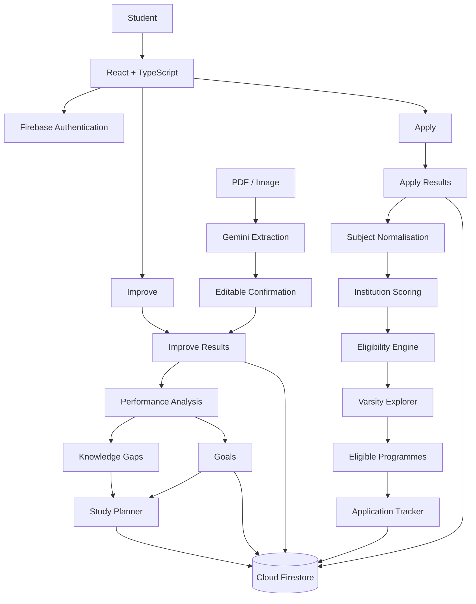

# 🎓 VarsityPath

### Personalised Academic Improvement & University Readiness for South African Students

[](https://react.dev/)
[](https://www.typescriptlang.org/)
[](https://firebase.google.com/)
[](https://firebase.google.com/docs/firestore)
[](https://ai.google.dev/)
[](#)
[](#)

> **VarsityPath** is a personalised education and university-readiness platform designed to help South African Grade 11–12 students understand their academic performance, improve their results, discover suitable university programmes, and track applications.

---

## 📌 Overview

Choosing a university programme can be difficult when students don't know:

* where they are academically strong,
* which subjects need improvement,
* what their knowledge gaps are,
* what admission scores mean,
* which programmes they qualify for,
* or how to keep track of applications.

VarsityPath brings these steps together into one platform.

The application is built around two connected but independent experiences:

### 📚 Improve

```text
Results
   ↓
Performance Analysis
   ↓
Knowledge Gaps
   ↓
Goals
   ↓
Smart Study Planner
```

### 🎓 Apply

```text
Apply Results
   ↓
Institution-Specific Score
   ↓
Eligibility Engine
   ↓
Courses You Qualify For
   ↓
Application Tracker
```

The two result systems remain intentionally separate so that academic improvement data cannot accidentally be treated as university application data.

---

# ✨ Features

## 📊 Academic Improvement

Students can enter their academic results manually or upload supported result documents.

Improve results support:

* Subject
* Topic
* Mark
* Date

The dashboard uses real student results to calculate:

* subject strengths,
* weak areas,
* knowledge gaps,
* learning priorities,
* and study recommendations.

---

## 🧠 Knowledge Gaps

VarsityPath identifies areas where a student may need additional practice.

Instead of simply showing:

> Mathematics: 45%

the platform aims to provide actionable information such as:

> Algebra needs attention.

Knowledge gaps can be converted into study tasks.

---

## 📄 AI Result Extraction

Students can upload supported PDF or image result documents.

The processing pipeline is:

```text
PDF / Image
     ↓
Gemini
     ↓
Structured Results
     ↓
Student Review
     ↓
Edit / Delete / Add
     ↓
Confirm
     ↓
Firestore
```

AI extraction is treated as a **draft**, not as an automatic source of truth.

Students must review and confirm extracted information before it is persisted.

For production AI integrations, API credentials should remain protected server-side rather than being exposed in client code.

---

# 🎯 Smart Study Planner

The Study Planner uses actual student performance to help prioritise study.

Students can:

* create goals,
* create study tasks,
* prioritise weak subjects,
* work on knowledge gaps,
* schedule tasks,
* mark tasks complete,
* reschedule tasks,
* and monitor weekly progress.

Example:

```text
Goal
Improve Mathematics
48% → 65%

        ↓

Weak Topic
Algebra

        ↓

Study Task
Practice simultaneous equations
45 minutes
High priority
```

---

# 🎓 Varsity Explorer

VarsityPath includes a university programme discovery system for:

* 🟦 University of Cape Town (UCT)
* 🟦 Stellenbosch University
* 🟦 University of the Western Cape (UWC)
* 🟦 Cape Peninsula University of Technology (CPUT)

The platform does **not** use one generic APS calculation for every institution.

Instead, the eligibility engine uses institution- and programme-specific rules.

```text
Student Apply Results
        ↓
Subject Normalisation
        ↓
Institution Scoring
        ↓
Programme Requirements
        ↓
Eligibility Evaluation
        ↓
Eligible Programmes
```

Only programmes that the student currently qualifies for are intended to appear in the Varsity Explorer.

---

# 🧮 Eligibility Engine

The eligibility engine is deterministic rather than relying on an LLM to decide whether a student qualifies.

A programme can contain:

```ts
{
  id,
  institutionId,
  name,
  qualificationType,
  faculty,
  officialUrl,
  scoringMethod,
  minimumScore,
  requiredSubjects,
  subjectRequirements,
  additionalRequirements,
  selectionRequirements,
  academicYear,
  lastVerified
}
```

Eligibility can evaluate:

* minimum admission scores,
* required subjects,
* minimum subject marks,
* Mathematics vs Mathematical Literacy,
* English requirements,
* AND/OR requirements,
* institution-specific scoring,
* programme-specific requirements,
* and additional selection criteria.

The system should explain why a student qualifies rather than simply displaying a yes/no result.

> **Important:** Meeting published minimum requirements does not guarantee admission.

---

# 📝 Application Tracker

Eligible programmes can be connected to the Application Tracker.

Students can track:

* university,
* programme,
* application status,
* deadlines,
* notes,
* and application history.

Example workflow:

```text
Eligible Programme
      ↓
Track Application
      ↓
In Progress
      ↓
Submitted
      ↓
Under Review
      ↓
Accepted / Rejected / Waitlisted
```

VarsityPath does **not** automatically submit university applications.

---

# 🔐 Authentication & Data Privacy

VarsityPath uses Firebase Authentication for student accounts.

Private student data is scoped by the authenticated Firebase UID.

The intended structure is:

```text
users/
└── {userId}/
    ├── improveResults/
    ├── applyResults/
    ├── goals/
    ├── studyTasks/
    └── applications/
```

This keeps student data isolated between accounts.

Firestore security rules are used as the security boundary rather than relying only on frontend filtering.

---

# 🏗️ Architecture



---

# 🗂️ High-Level Project Structure

```text
varsitypath/
│
├── src/
│   ├── components/
│   ├── pages/
│   ├── data/
│   │   └── programmes/
│   ├── services/
│   │   ├── firebase/
│   │   ├── eligibility/
│   │   ├── scoring/
│   │   ├── studyPlanner/
│   │   └── applications/
│   ├── types/
│   ├── utils/
│   └── App.tsx
│
├── functions/
│   └── ...
│
├── public/
│   └── ...
│
├── firestore.rules
├── firestore.indexes.json
├── firebase.json
├── .env.example
├── package.json
├── tsconfig.json
└── README.md
```

> Adjust this structure to match the actual repository if your implementation uses different folders.

---

# 🛠️ Tech Stack

| Technology                  | Purpose                                  |
| --------------------------- | ---------------------------------------- |
| **React**                   | Frontend UI                              |
| **TypeScript**              | Type-safe application development        |
| **Tailwind CSS**            | Styling and responsive design            |
| **Firebase Authentication** | Student authentication                   |
| **Cloud Firestore**         | Student data and application persistence |
| **Google Gemini**           | Result-document extraction               |
| **Vite**                    | Development/build tooling                |

Firebase provides the authentication and Firestore infrastructure, while Gemini is used for AI-powered document extraction. Firebase also provides current tooling for integrating AI capabilities into web applications.

---

# 🚀 Getting Started

## Prerequisites

Make sure you have:

* Node.js 18+
* npm
* A Firebase project
* Firebase Authentication enabled
* Cloud Firestore enabled
* Gemini/Google AI configuration for document extraction

---

## 1. Clone the repository

```bash
git clone https://github.com/YOUR_USERNAME/varsitypath.git

cd varsitypath
```

Replace `YOUR_USERNAME` with your GitHub username.

---

## 2. Install dependencies

```bash
npm install
```

---

## 3. Configure environment variables

Create a local environment file:

```bash
cp .env.example .env
```

Then add your development configuration.

Example:

```env
VITE_FIREBASE_API_KEY=
VITE_FIREBASE_AUTH_DOMAIN=
VITE_FIREBASE_PROJECT_ID=
VITE_FIREBASE_STORAGE_BUCKET=
VITE_FIREBASE_MESSAGING_SENDER_ID=
VITE_FIREBASE_APP_ID=

GEMINI_API_KEY=
```

**Do not commit `.env` to GitHub.**

If Gemini is called through a server-side endpoint, keep the Gemini credential on the server rather than exposing it through `VITE_*` client variables. The Google Gen AI SDK documentation specifically cautions against exposing API keys in client-side production applications.

---

## 4. Start the development server

```bash
npm run dev
```

Then open the local development URL shown in the terminal.

---

# 🔥 Firebase Setup

Create or select a Firebase project.

Enable:

### Authentication

Enable the authentication providers required by VarsityPath.

For the current implementation, email/password authentication can be used for:

* account creation,
* sign in,
* sign out,
* persistent sessions.

### Cloud Firestore

Create the Firestore database and deploy the project's security rules.

Example:

```bash
firebase deploy --only firestore:rules
```

Also deploy required indexes when applicable:

```bash
firebase deploy --only firestore:indexes
```

Firestore is a document-oriented database designed for storing and synchronising application data.

---

# 🧪 Testing

Run the project's configured test suite:

```bash
npm test
```

If the repository uses separate commands, also run:

```bash
npm run lint
npm run build
```

Before production deployment, verify:

* authentication,
* Firestore security,
* Improve results,
* Apply results,
* eligibility calculations,
* programme filtering,
* Study Planner,
* Application Tracker,
* document extraction,
* mobile responsiveness.

---

# 🔒 Security Principles

VarsityPath follows several important security principles:

### 1. User-owned data

Student records are scoped to the authenticated user's UID.

### 2. Firestore rules

Security rules enforce ownership at the database level.

### 3. No fake student data

The application should never populate student dashboards with fake results.

### 4. AI extraction requires confirmation

Gemini-generated extraction is treated as provisional until the student confirms it.

### 5. Deterministic eligibility

AI should not make the final decision about whether a student qualifies for a programme.

Eligibility is calculated from structured programme requirements.

### 6. Secret protection

Private API credentials must not be exposed in client-side source code.

---

# 🎨 Design System

VarsityPath uses a calm academic colour palette designed to feel modern, trustworthy, and approachable.

| Colour        | Hex       |
| ------------- | --------- |
| Cloud Blue    | `#EDF4FA` |
| Powder Sky    | `#CFE3F1` |
| Calm Ocean    | `#8FB6D8` |
| Dusty Denim   | `#5F86A6` |
| Midnight Blue | `#243A5E` |

The interface uses:

* clean cards,
* rounded components,
* clear hierarchy,
* responsive layouts,
* readable typography,
* accessible interaction states.

---

# 🗺️ Roadmap

## ✅ Phase 1 — Foundation

* [x] React/TypeScript application
* [x] Firebase integration
* [x] Authentication
* [x] Firestore user isolation
* [x] Improve / Apply navigation
* [x] Responsive design foundation

## ✅ Phase 2 — Improve

* [x] Manual result entry
* [x] Improve result persistence
* [x] Result history
* [x] Document upload pipeline
* [x] Gemini extraction
* [x] Editable extraction confirmation
* [x] Knowledge-gap analysis
* [x] Goals
* [x] Study Planner

## ✅ Phase 3 — Apply

* [x] Independent Apply Results
* [x] 7-subject requirement
* [x] Subject normalisation
* [x] Institution-specific scoring architecture
* [x] Eligibility engine
* [x] Varsity Explorer
* [x] Eligible-programme filtering

## ✅ Phase 4 — Applications

* [x] Application Tracker
* [x] Application statuses
* [x] Application notes
* [x] Deadline tracking
* [x] Application history

## 🚧 Phase 5 — Production Readiness

* [ ] Full security audit
* [ ] Firestore rules audit
* [ ] Production environment configuration
* [ ] API-secret audit
* [ ] Full automated test coverage
* [ ] Mobile QA
* [ ] Accessibility audit
* [ ] Performance optimisation
* [ ] Production deployment
* [ ] Monitoring and error tracking

## 🔮 Future Ideas

Potential future improvements include:

* [ ] More South African universities
* [ ] More verified programme data
* [ ] Improved study recommendations
* [ ] NBT preparation resources
* [ ] Scholarship and funding discovery
* [ ] University open-day information
* [ ] Application deadline reminders
* [ ] Calendar integration
* [ ] Student progress insights
* [ ] Additional document formats

Future features should only be added after the core eligibility, security, and data-quality systems are reliable.

---

# 🎯 Project Goals

VarsityPath aims to make the transition from high school to university more understandable and actionable.

Instead of students having to jump between multiple systems:

```text
Results
   +
University Requirements
   +
Study Planning
   +
Applications
```

VarsityPath brings these experiences into one student journey:

```text
┌─────────────────────────────┐
│         UNDERSTAND          │
│        Your Results         │
└──────────────┬──────────────┘
               ↓
┌─────────────────────────────┐
│          IMPROVE            │
│     Gaps → Goals → Tasks    │
└──────────────┬──────────────┘
               ↓
┌─────────────────────────────┐
│          EXPLORE            │
│   Find Eligible Programmes  │
└──────────────┬──────────────┘
               ↓
┌─────────────────────────────┐
│           APPLY             │
│      Track Applications     │
└─────────────────────────────┘
```

---

# ⚠️ Important Disclaimer

VarsityPath is an educational planning and guidance platform.

Programme requirements, admission scores, selection criteria, deadlines, and institutional policies can change.

VarsityPath should use verified official university information and clearly display the relevant official source.

Meeting a published minimum requirement does **not** guarantee admission.

Students should always verify final requirements and application information with the relevant university.

---

# 🤝 Contributing

Contributions, ideas, bug reports, and improvements are welcome.

Before submitting a pull request:

```bash
npm run lint
npm test
npm run build
```


---


## 👨🏽‍💻 Built With Purpose

**VarsityPath** is being built to help South African learners make better-informed decisions about their academic improvement and university journey.

> **Understand your results. Improve your performance. Find your path.**
